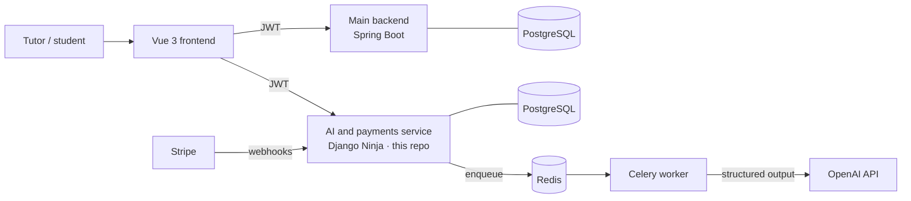

# e-Tutor AI · backend

The AI and payments service of **e-Tutor**, a platform for private tutors to manage students, lessons and teaching materials. It turns a topic or a piece of study material into a ready-to-use quiz, explains answers at three levels of detail, and handles subscriptions.

Built as an engineering diploma project (WSB Merito University, 2025) by a team of three. I was the main author of this service: AI generation, asynchronous processing, token metering, Stripe payments and the Docker Compose setup.

Generating a quiz with a large language model takes 15–30 seconds and every request costs tokens. The service is designed around those two facts: generation runs **asynchronously** in a worker, and every user's **token usage is metered** against the limits of their subscription plan.

## Where it fits

e-Tutor is split into three services that talk over REST with JWT:



- The **main backend** (Spring Boot) owns users, lessons, quizzes and contacts, and issues the JWT at login.
- **This service** trusts that JWT and keeps only an `ExternalUser` keyed by an external UUID, so user accounts live in one place.
- **Database per service**: each backend has its own PostgreSQL instance, so they can evolve and scale independently.

## Decisions and why

| Decision | Why |
|---|---|
| A separate AI service instead of a monolith | Generation is slow and paid per token, so it should scale on its own. If OpenAI limits are hit, users can still log in, see lessons and solve existing quizzes. |
| Asynchronous generation (Celery + Redis) | A 15–30 s model call must not block an HTTP request. The API returns a task id and the client polls for the result. |
| Django Ninja instead of Django REST Framework | Ninja and the OpenAI SDK both use Pydantic, so the model's structured output maps straight onto API schemas without a conversion layer, while keeping the Django ORM and admin. |
| Structured output from the model | The response is parsed into typed schemas, so the API never returns free-form text where JSON is expected. |
| Stripe with webhooks | Subscription state follows Stripe events (checkout, renewal, failed payment, cancellation); card data never touches the service. |
| Docker Compose, not Kubernetes | At this scale Compose gives a reproducible environment without the operational overhead. |

## What it does

- **Quiz generation** from a topic or content: single choice, multiple choice, fill in the blanks, ordering and true/false questions, five difficulty levels.
- **Hints and solutions** at three levels: a nudge, a detailed hint that can rule out wrong options, or the full answer with an explanation.
- **Token metering**: input and output tokens are recorded per user and checked against daily, weekly and monthly limits of the plan.
- **Subscriptions**: plans, checkout, cancellation and reactivation, driven by Stripe webhooks.
- `POST /api/quiz/quizzes` starts generation and returns a task id. `GET /api/quiz/quizzes/result/{task_id}` returns the result once ready, and only to the user who requested it.

About 15 endpoints and 9 tables; roughly 4,500 lines of Python.

## Stack

Python · Django 5 · Django Ninja · Celery · Redis · PostgreSQL · OpenAI API (structured outputs) · Stripe · Docker Compose · Flower · Ruff and pre-commit

## Running locally

```bash
cp backend_ai/.env.example backend_ai/.env   # fill in the keys and the admin credentials
docker compose -f docker-compose-dev.yml up --build
```

- API: http://localhost:8000, interactive docs at http://localhost:8000/api/docs
- Celery worker and Redis start with the stack; PostgreSQL listens on port 5433.
- On first start the container runs migrations, creates an admin account from the `DJANGO_SUPERUSER_*` variables and seeds subscription plans.
- Stripe needs `STRIPE_SECRET_KEY` and `STRIPE_WEBHOOK_SECRET` in `.env` (not yet listed in `.env.example`).
- The frontend and the main Spring Boot backend live in separate repositories.

## Status and next steps

A diploma project, not a production service. Testing was done at the API and integration level plus performance tests of generation; there are no unit tests yet. Next steps I would take:

- Add unit tests, starting with token limits, generation and webhook handling.
- Tighten error handling in the generation task (one `except` branch is unreachable) and add retries with backoff for model calls.
- Make webhook handling idempotent, so a repeated Stripe event cannot be applied twice.
- Complete `.env.example` with the Stripe variables.
